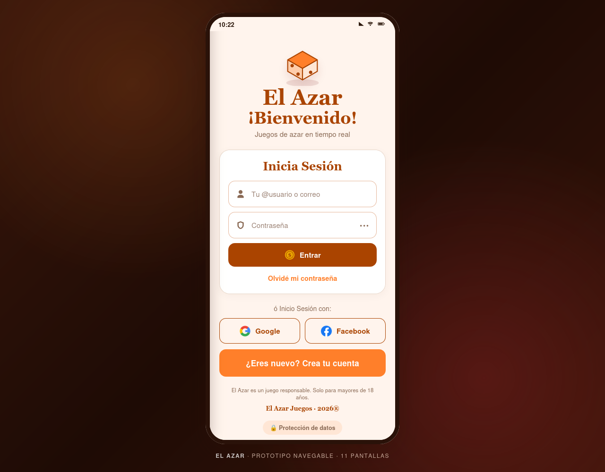
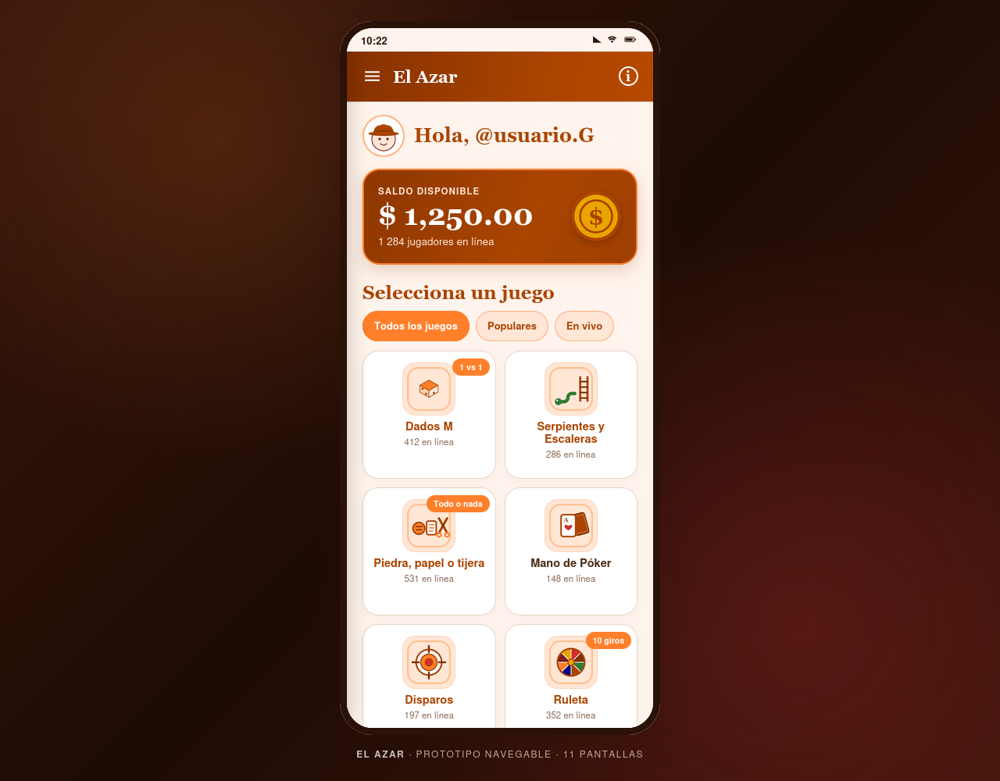
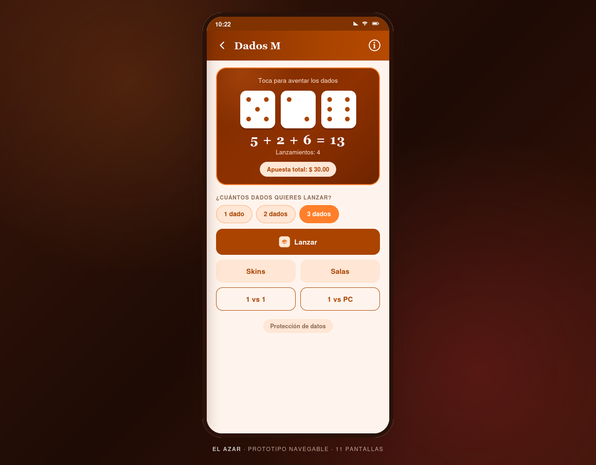
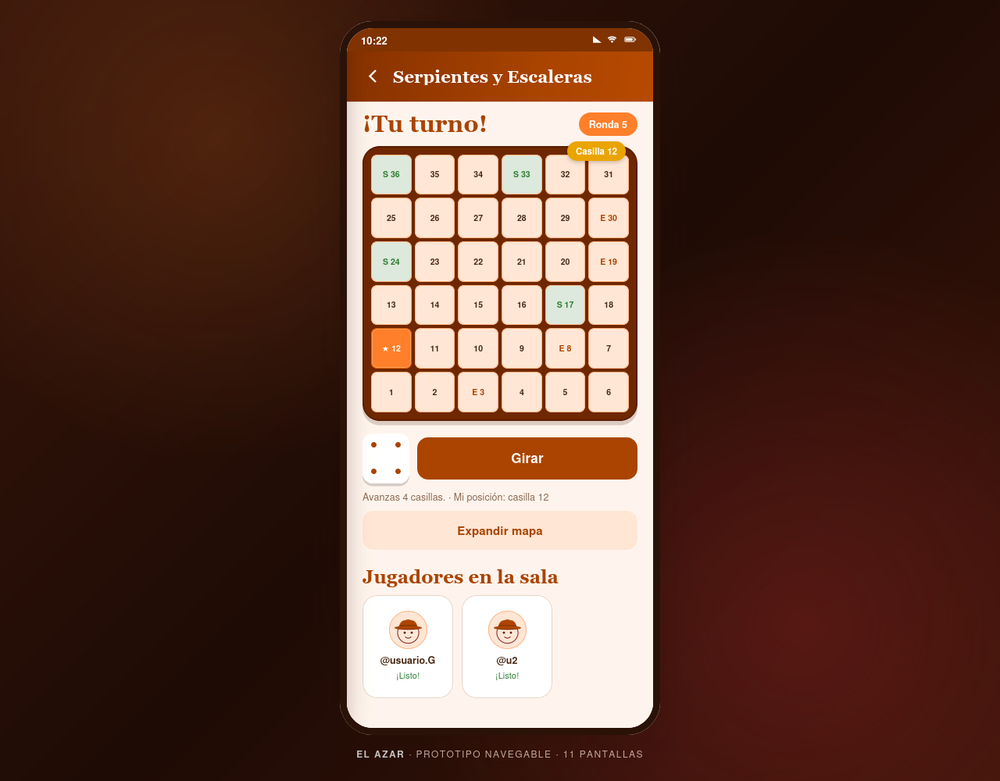
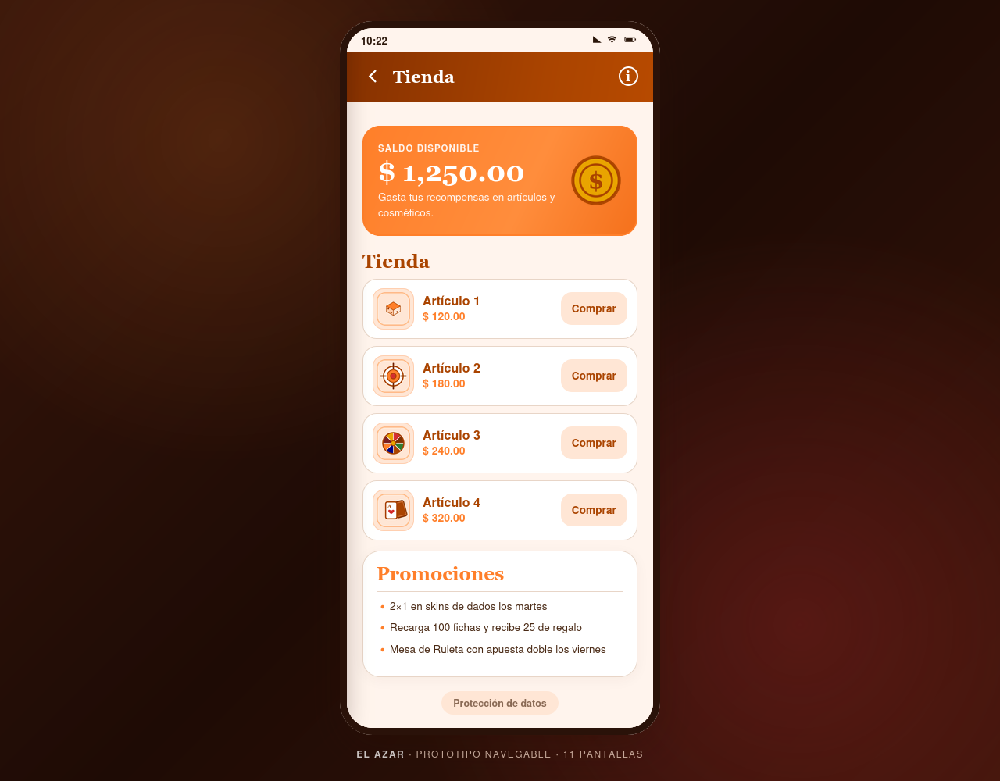
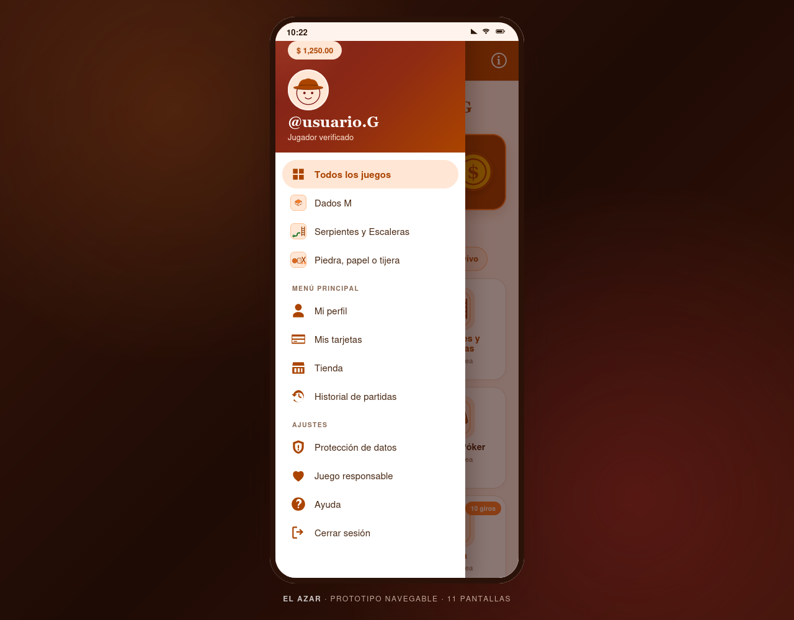

# El Azar · Prototipo navegable

Prototipo de alta fidelidad construido a partir de los **11 mockups** del proyecto
(`Reporte/assets/mockups/`). Reproduce la identidad visual de El Azar y permite
recorrer todas las pantallas usando únicamente los botones dibujados en cada
mockup: no requiere backend, instalación ni conexión a Internet.

## Cómo abrirlo

1. Abre `Prototipo/index.html` con cualquier navegador moderno (Chrome, Edge,
   Firefox o Safari). También puedes hacer doble clic sobre el archivo.
2. Para servirlo por HTTP (opcional):

   ```bash
   cd Prototipo
   python3 -m http.server 8000
   # Abre http://localhost:8000
   ```

El teléfono se adapta a la ventana: en escritorio aparece dentro de un marco y en
móvil ocupa toda la pantalla.

## Pantallas y navegación

| # | Mockup | Ruta | Botones que navegan |
|---|--------|------|---------------------|
| 1 | Inicio de sesión | `#login` | **Entrar**, **Google**, **Facebook** → Dashboard · **Crea tu cuenta** → Registro · **Olvidé mi contraseña** → diálogo |
| 2 | Crear cuenta | `#register` | **Registrarme** → Dashboard · **¿Ya tienes cuenta?** / flecha atrás → Login |
| 3 | Dashboard | `#dashboard` | Tarjetas de juego → Dados, Serpientes, PPT o Disparos · **☰** → Menú lateral · **ⓘ** → Menú de opciones |
| 4 | Alta de medio de pago | `#payment` | **Cancelar**, **Confirmar** y flecha atrás → Dashboard |
| 5 | Tienda | `#store` | Flecha atrás → Dashboard · **Comprar** actualiza el saldo · **ⓘ** → Menú de opciones |
| 6 | Dados M | `#dice` | Flecha atrás → Dashboard · **Lanzar** avanza la ronda · **ⓘ** → Menú de opciones |
| 7 | Serpientes y Escaleras | `#snakes` | Flecha atrás → Dashboard · **Girar** mueve la ficha · **Expandir mapa** |
| 8 | Piedra, papel o tijera | `#rps` | Flecha atrás → Dashboard · **Jugar ronda** resuelve la jugada |
| 9 | Disparos | `#shooter` | Flecha atrás → Dashboard · Tocar el blanco + **Disparar** |
| 10 | Menú lateral | `#drawer` | Juegos, **Mis tarjetas**, **Tienda**, opciones legales y **Cerrar sesión** → Login |
| 11 | Menú de opciones | `#options` | **Tienda**, **Mis tarjetas**, diálogos legales, **Compartir** y **Cerrar sesión** → Login |

Las rutas `#drawer` y `#options` abren las pantallas 10 y 11 directamente sobre
su vista de fondo, lo que resulta útil para revisar el prototipo o compartir un
enlace a una pantalla concreta.

### Flujos principales

```text
Login ──► Dashboard ──► Dados M ──────────────┐
  │           │  ├────► Serpientes y Escaleras │
  │           │  ├────► Piedra, papel o tijera │
  │           │  └────► Disparos               │
  │           ├────► Menú lateral ─────────────┤
  │           └────► Menú de opciones ─────────┤
  │                                            ▼
  └────► Crear cuenta ──► Dashboard      Tienda / Mis tarjetas
                                             │
                              Cerrar sesión ─┴──► Login
```

## Interacciones incluidas

Aunque el objetivo es la navegación, las pantallas de juego conservan pequeñas
interacciones para que el prototipo se sienta funcional:

- **Dados M:** cambia entre 1, 2 o 3 dados, lanza y calcula el total y la apuesta.
- **Serpientes y Escaleras:** tablero de 36 casillas, serpientes, escaleras y
  posición del jugador.
- **Piedra, papel o tijera:** selección de jugada y apuesta; resuelve la ronda.
- **Disparos:** apunta tocando el blanco, dispara y acumula puntaje.
- **Tienda:** descuenta el saldo al comprar.
- **Alta de tarjeta:** formatea el número y la fecha, y actualiza la vista previa.
- **Menús:** los diálogos de protección de datos, juego responsable, ayuda,
  información e historial se abren como capas sobre la pantalla actual.

## Estructura

```text
Prototipo/
├── index.html          # Las 11 pantallas y las capas de menús/diálogos
├── styles.css          # Identidad visual, componentes y adaptación a móvil
├── app.js              # Rutas, navegación, overlays y demostraciones
├── assets/             # Iconos e ilustraciones tomados de Reporte/assets
├── capturas/           # Capturas de las 11 pantallas
└── README.md
```

## Capturas

| | |
|---|---|
|  |  |
|  |  |
|  |  |

Todas las capturas están en `capturas/` y se generaron con:

```bash
firefox --headless --window-size=1280,1000 \
  --screenshot=capturas/03-dashboard.png \
  "file:///ruta/al/Prototipo/index.html?static#dashboard"
```

El parámetro `?static` desactiva las animaciones para que la captura sea estable;
no es necesario para usar el prototipo.

## Notas

- Es un prototipo **sin backend**: el usuario, el saldo y las partidas viven en
  memoria y se reinician al recargar la página.
- Los juegos **Póker** y **Ruleta** aparecen en el dashboard porque forman parte
  del catálogo del proyecto, pero no tienen mockup propio; al pulsarlos muestran
  un aviso en lugar de navegar a una pantalla inexistente.
- La aplicación Android existente en `ElAzar/` se conserva como implementación
  nativa del proyecto. Este prototipo es una versión autónoma y navegable pensada
  para revisar la experiencia completa de los mockups sin compilar.
